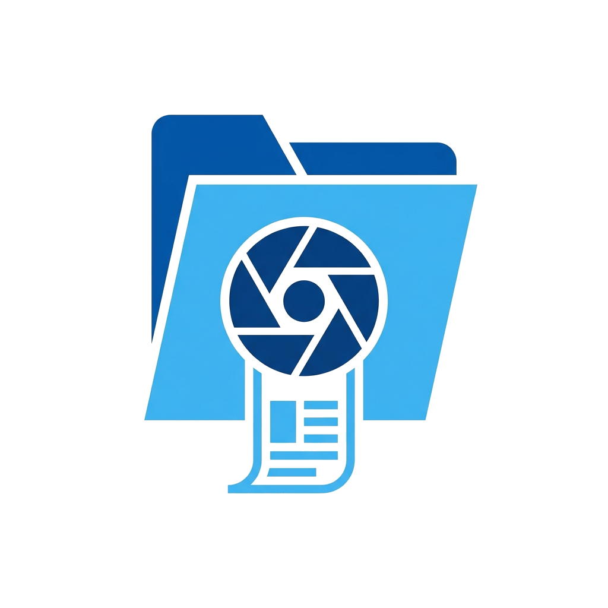

<div align="center">



# FolderSnap 📸

**一键把文件夹变成「可交付的截图」—— Windows 原生资源管理器长截图 + 批量归档工具**

[](LICENSE)


[简体中文](README.md) · [English](README.en.md) · [⬇️ 下载](../../releases/latest)

</div>

---

## 😩 你是不是也遇到过？

- 📋 **验收/软著/审计**：要交一份「目录结构截图」，却要手动一屏一屏截、拼、再标注路径……
- 💬 **跟同事说清「文件放哪了」**：截图只有一半，列被挤成 `...`，对方还是找不到
- 🗂️ **素材库/项目归档**：几十个子文件夹，每个都要截一张，截到手酸
- 🧾 **交付凭证**：图片里没路径、没时间、没文件数，甲方不认

**FolderSnap 就是为这些场景而生。**

## ✨ 它能做什么

| | 功能 | 一句话 |
|---|---|---|
| 🪟 | **100% 原生资源管理器** | 内嵌系统 `IExplorerBrowser`，真实图标、真实列、真实右键 —— 不是网页模拟 |
| 📜 | **长列表无缝拼长图** | 自动滚动翻页，数百个文件拼成一张像素对齐的整图 |
| ⚡ | **全自动批量截图** | 递归子文件夹（可限 1/2/3 层），逐个导航、逐个落盘，随时 `ESC` 安全中断 |
| 📋 | **截完即上剪贴板** | 保存 PNG 的同时写入剪贴板，直接 `Ctrl+V` 到微信/飞书/钉钉/Word |
| 🏷️ | **工程交付页眉** | 矢量路径 + 条目总数 + 时间戳，验收、软著、审计一看就懂 |
| 🔍 | **智能列宽防截断** | 自动撑开文件名列，告别 `...` |
| 👀 | **4 种视图** | 详细信息 / 大图标 / 列表 / 平铺，按场景切换 |
| 🛡️ | **自动忽略依赖目录** | 默认跳过 `.git` `node_modules` `bin` `obj` |
| 🧳 | **绿色单文件** | ~95KB，无需安装，无需 Node / Python / Electron |

## 🎬 典型使用场景

1. **软著 / 项目验收**：选根目录 → 开启「工程页眉」→ 批量截图，几分钟拿到整套带路径的目录图。
2. **设计师素材归档**：切到「大图标」视图，一键导出每个素材文件夹的预览图。
3. **交接与汇报**：「仅截当前」→ 直接粘贴到群聊，对方一眼看清目录结构。
4. **审计 / 合规留痕**：带时间戳与条目数的截图，天然是「证据」。
5. **文档写作**：给教程、README、Wiki 快速配上真实的目录截图。

## 🚀 快速开始

1. 到 [Releases](../../releases/latest) 下载 `FolderSnapDesktop.exe`
2. 双击运行；拖入文件夹，或在左侧目录树点选
3. 点 **📸 仅截当前** 或 **⚡ 开始全自动批量截图**

> 系统要求：Windows 10 / 11（x64，自带 .NET Framework 4.x）

## 🛠️ 自行构建

```bat
desktop\build.bat
```
仅依赖 Windows 自带的 C# 编译器 `csc.exe`，几秒完成。

## 🌐 附：Web 免安装体验版

不想装软件？[`web/`](web/) 目录提供纯前端版本（浏览器打开 `web/index.html`），支持文件夹卡片渲染与 ZIP 打包，适合跨平台尝鲜。

## 📐 技术内幕

COM 宿主 `IExplorerBrowser`、Win32 `SysListView32` 列宽控制、`SCROLLINFO` 滚动拼接……详见 [`docs/`](docs/) 中的 ADR 与 [术语表](docs/GLOSSARY.md)，以及 [桌面版详细文档](desktop/README.md)。

## 🤝 参与贡献

欢迎 Issue / PR！想法、Bug、新场景都可以提。如果它帮到了你，给个 ⭐ 就是最大的鼓励。

## 📄 License

[MIT](LICENSE)
